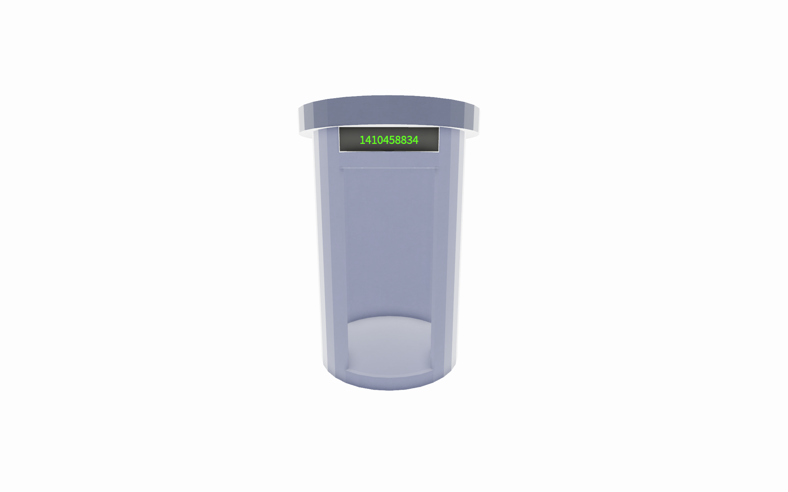
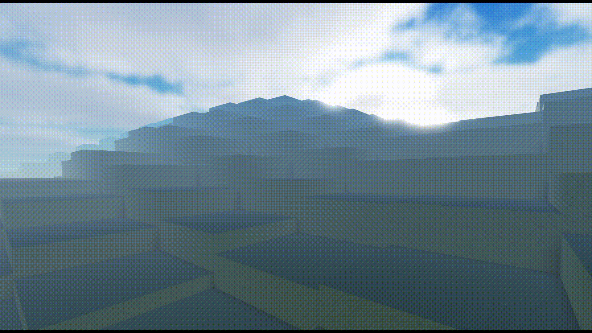

# Procedural World Generator

A procedural world generator made with Luau. The project includes: a central hub and deterministically-generated worlds using seeds.

## Overview

This is a showcase of the projects's most major/interesting systems. Not all code is included.

## Highlights

### 1. Central Hub

The central hub exists to transport players to any one of the worlds. Players can input their own world seed or have it randomly generated for them. This seed creates a portal tied to the selected seed. If the portal is walked into and then closed, all players inside will teleport to the world.

**Selected source code:** [oceanMovement.lua](Source/Hub/Server/serverPortalHandler.lua)

### 2. Generation

The generation system uses the world seed to deterministically create all attributes of the world. Some of these attributes include:
* Terrain size/height/color/material/shape
* Prop selection/count/size/etc (trees, bushes)
* Ocean
* Atmosphere
* Sun + moon size
* Day length
* Weather
* +Much more

**Selected source code:** [worldSettingsModule.lua](Source/Generation/Modules/worldSettingsModule.lua)